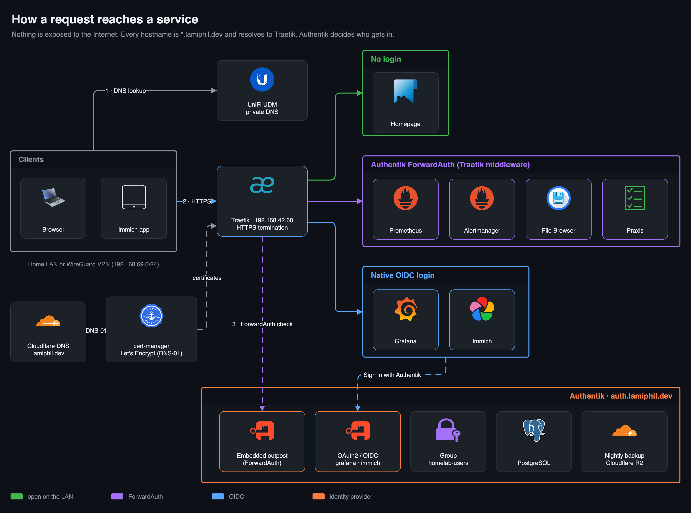
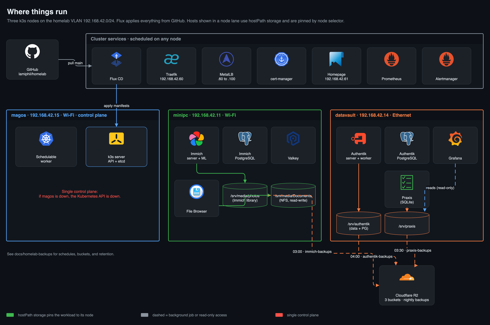

# Homelab

GitOps-powered home Kubernetes cluster built with k3s, Flux CD, SOPS/age, MetalLB, Traefik, cert-manager, Authentik, and UniFi networking.

## Highlights

- **Network edge**: UniFi UDM, WireGuard VPN, Cloudflare DDNS
- **Main VLANs**:
  - home/client VLAN: `192.168.0.0/24`
  - homelab VLAN: `192.168.42.0/24`
  - WireGuard VPN: `192.168.69.0/24`
- **Cluster nodes**:
  - `magos` — single control plane and schedulable worker
  - `minipc` — worker for Immich, File Browser, and Homepage
  - `datavault` — worker and storage node for Authentik, Praxis, and Grafana
- **Applications**: Authentik, Homepage, Immich, File Browser, Praxis, Grafana, Prometheus, Alertmanager
- **Service exposure**: everything goes through Traefik at `192.168.42.60` with Let's Encrypt TLS. Only Homepage keeps its own MetalLB IP (`192.168.42.61`).
- **Single sign-on**: Authentik at `https://auth.lamiphil.dev` protects every service except Homepage.

`ubuntuserver`, `pi`, and `archlinux` were retired on 2026-11-15.

## How a request reaches a service

Nothing is exposed to the Internet. Clients on the home network or on WireGuard resolve `*.lamiphil.dev` through the UDM, which answers `192.168.42.60` (Traefik). Traefik terminates TLS, then each service is protected in one of three ways.

| Service | URL | Access |
|---------|-----|--------|
| Homepage | `https://homepage.lamiphil.dev` | Open on the LAN |
| Prometheus | `https://prometheus.lamiphil.dev` | Authentik ForwardAuth |
| Alertmanager | `https://alertmanager.lamiphil.dev` | Authentik ForwardAuth |
| File Browser | `https://filebrowser.lamiphil.dev` | Authentik ForwardAuth, then File Browser login |
| Praxis | `https://praxis.lamiphil.dev` | Authentik ForwardAuth, then Praxis login |
| Grafana | `https://grafana.lamiphil.dev` | Authentik OIDC (local admin login as fallback) |
| Immich | `https://immich.lamiphil.dev` | Authentik OIDC, web and mobile (password login at `/auth/login?autoLaunch=0`) |
| Authentik | `https://auth.lamiphil.dev` | Authentik itself |

Access requires membership in the Authentik group `homelab-users`. Protected services have no LoadBalancer IP, so Authentik cannot be bypassed.

## Where things run

Placement of Grafana, Authentik, Praxis, Immich, and File Browser is pinned by node selectors because they use hostPath storage. Other workloads go wherever the scheduler places them.

## Documentation

- `AGENTS.md` — operating guide: IPs, storage, secrets, backups, restore steps, and SSO details.
- `_log.md` — work journal with decisions and live-cluster operations.
- `docs/*.drawio` — diagram sources. Open them in draw.io; the `.drawio.png` exports also embed the editable diagram.
